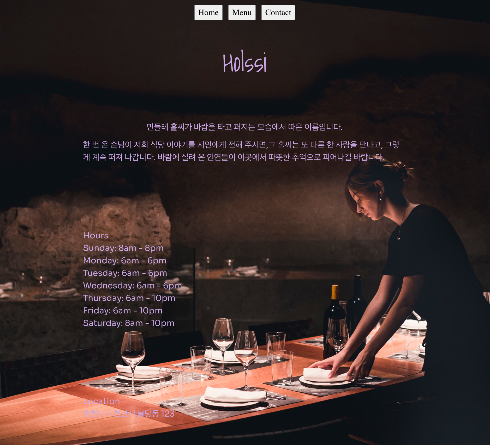

Holssi (홀씨) — Restaurant Page
바닐라 JavaScript로 화면을 구성하는 학습용 레스토랑 소개 페이지입니다.
홈 화면에서 식당 소개, 영업시간, 위치를 확인하고,
Home · Menu · Contact 버튼으로 화면을 전환할 수 있습니다.

화면별 코드를 ES Modules로 나누고, Webpack으로 JavaScript·CSS·이미지를
처리하는 과정을 연습했습니다.
The Odin Project의 Restaurant Page 과제를 바탕으로 제작했습니다.

현재 홈 화면과 탭 전환의 기본 구조를 구현한 버전이며,
나머지 화면의 상세 내용과 문서는 계속 보완할 예정입니다.
데모
배포 주소 추가 예정입니다.

<!-- 배포 완료 후 이 문장을 실제 사이트 링크로 교체하세요. -->

  

주요 기능

- JavaScript로 홈 화면의 DOM 요소 생성
- 홈 화면에 식당 소개, 영업시간, 위치 정보 표시
- Home · Menu · Contact 버튼을 통한 탭 전환
- 탭을 전환할 때 기존 내용을 비우고 선택한 화면을 표시해 화면 누적 방지
- 화면별 JavaScript 모듈 분리와 CSS를 이용한 기본 스타일 적용
  사용 기술
- HTML5
- CSS3
- JavaScript (ES Modules)
- npm
- Webpack · webpack-dev-server
- HtmlWebpackPlugin
- css-loader · style-loader
- Webpack Asset Modules (asset/resource)
  시작하기
  Node.js와 npm이 설치된 환경에서 실행할 수 있습니다.
  저장소를 클론하거나 소스 코드를 내려받은 뒤,
  package.json이 있는 프로젝트 루트 디렉터리에서 아래 명령을 실행하세요.
  npm install
  npx webpack serve
  실행 후 터미널에 표시되는 개발 서버 주소로 접속하세요.

빌드 결과 파일이 필요하면 다음 명령을 실행합니다.
npx webpack
생성된 HTML, JavaScript 및 이미지 등의 빌드 결과는 dist/에 저장됩니다.
문서 보완 예정
다음 항목은 개발 내용을 정리하면서 순차적으로 추가할 예정입니다.

- 설계 개요: 파일 구조와 각 모듈의 역할
- 진행 흐름: 초기 화면 표시와 탭 전환 과정
- 배운 점: 구현 중 겪은 문제와 해결 과정
- AI 활용 범위: README.md 초안 작성
- 보완할 점과 확장 아이디어: 남은 작업과 개선 방향
  감사의 말
- 프로젝트 과제와 학습 자료를 제공한 The Odin Project
