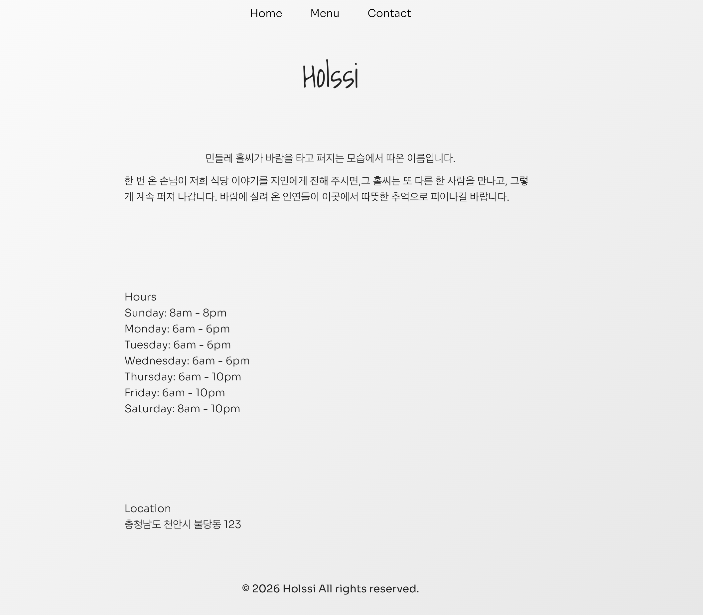
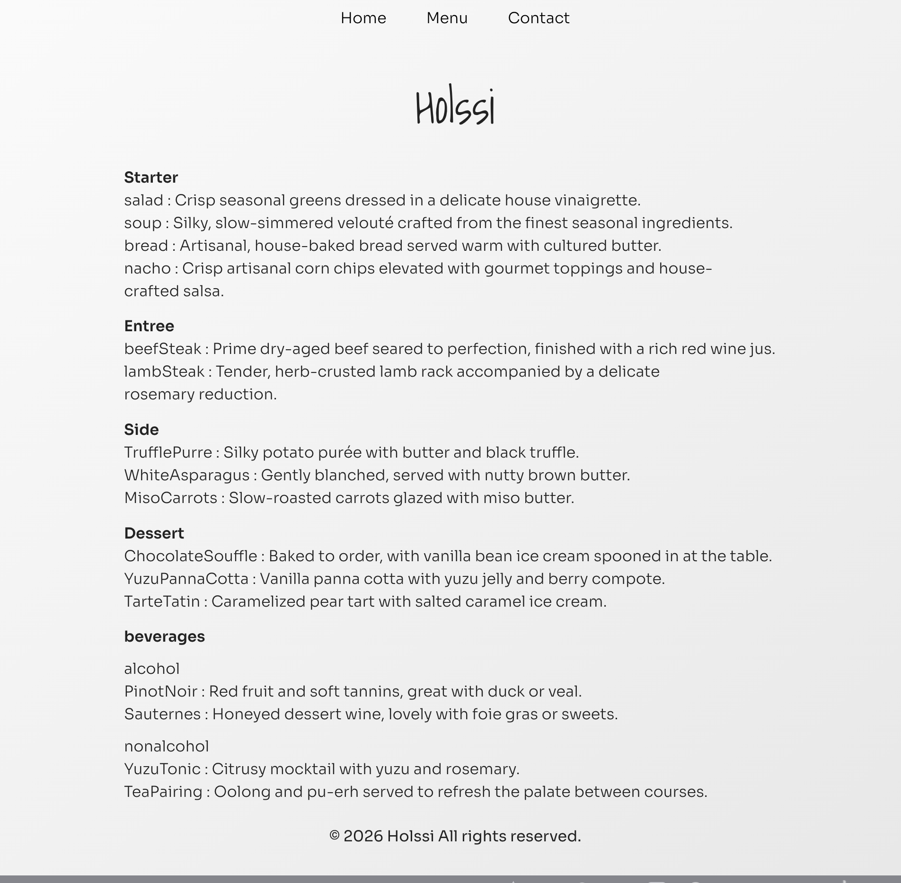
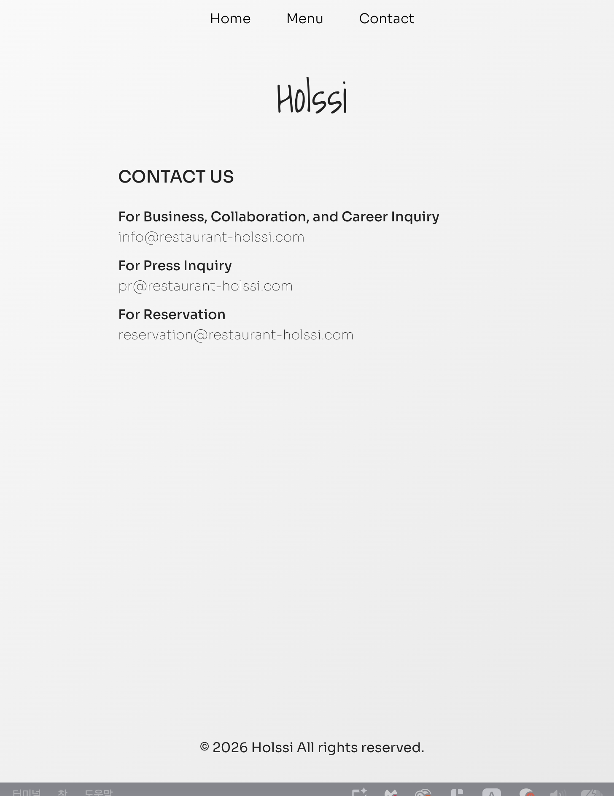

# Holssi (홀씨) — Restaurant Page

바닐라 JavaScript로 화면을 구성하는 레스토랑 소개 페이지입니다.
홈 화면에서 식당 소개, 영업시간, 위치를 확인하고,
메뉴 화면은 음식 순서로 보여주며, 연락 화면에서는 연락처를 표시했습니다.

Home · Menu · Contact 버튼으로 화면을 전환할 수 있습니다.

화면별 코드를 ES Modules로 나누고, Webpack으로 JavaScript·CSS·이미지를
처리하는 과정을 연습했습니다.
The Odin Project의 Restaurant Page 과제를 바탕으로 제작했습니다.

## 데모

[데모 링크](https://jhoncarmack.github.io/Restaurant-Page/)

## 스크린샷

  
  
  

## 주요 기능

- JavaScript로 홈, 메뉴, 연락처 화면의 DOM 요소 생성
- 홈 화면에 식당 소개, 영업시간, 위치 정보 표시
- 메뉴 화면에 메뉴 표시
- 연락처 화면에 연락처 정보 표시
- Home · Menu · Contact 버튼을 통한 탭 전환
- 탭을 전환할 때 기존 내용을 비우고 선택한 화면을 표시해 화면 누적 방지
- 화면별 JavaScript 모듈 분리와 CSS를 이용한 기본 스타일 적용

## 사용 기술

- HTML5
- CSS3
- JavaScript (ES Modules)
- npm
- Webpack · webpack-dev-server
- HtmlWebpackPlugin
- css-loader · style-loader
- Webpack Asset Modules (asset/resource)

## 시작하기

Node.js와 npm이 설치된 환경에서 실행할 수 있습니다.
저장소를 클론하거나 소스 코드를 내려받은 뒤,
package.json이 있는 프로젝트 루트 디렉터리에서 아래 명령을 실행하세요.
npm install
npx webpack serve
실행 후 터미널에 표시되는 개발 서버 주소로 접속하세요.

빌드 결과 파일이 필요하면 다음 명령을 실행합니다.
npx webpack
생성된 HTML, JavaScript 및 이미지 등의 빌드 결과는 dist/에 저장됩니다.

## 설계 개요

- index.js: 화면별 모듈을 불러와 초기 홈 화면을 표시하고, 탭 버튼의 클릭 이벤트를 등록합니다.

- Home.js, menu.js, contact.js: 각 화면에 필요한 DOM 요소를 생성합니다.

- styles.css: 페이지의 레이아웃과 화면별 스타일을 정의합니다.

## 진행 흐름

1. npx webpack을 실행하면 Webpack이 진입점인 index.js에서 import 관계를 따라 필요한 파일을 처리합니다.

2. main.js를 비롯한 빌드결과가 dist/에 만들어집니다.

3. 브라우저에서 빌드된 페이지를 열면 초기 홈 화면이 표시됩니다.

4. 탭 버튼을 누르면 #content의 기존 내용을 비우고, 해당 모듈의 함수를 호출해 선택한 화면을 표시합니다.

## 배운 점

- 화면 별 코드를 여러 모듈로 나누고, 진입점인 index.js에서 연결하는 방법을 배웠습니다. 또한
  Webpack의 빌드과정과 브라우저에서 화면이 표시되는 실행 과정을 구분하게 되었습니다

- 구현 중에는 화면을 생성하는 함수 안에서 이벤트를 등록하면 반복 호출 시 이벤트가 중복 등록될 수 있다는 점을 배웠습니다.
  이를 해결하기 위해 화면 생성은 각 모듈에서 담당하고, 클릭 이벤트는 index.js에서 한번 등록하도록 분리했습니다.

## Ai활용범위

- README.md 첨삭

## 감사의 말

- [프로젝트 과제와 학습 방향을 제공](https://www.theodinproject.com/dashboard)
